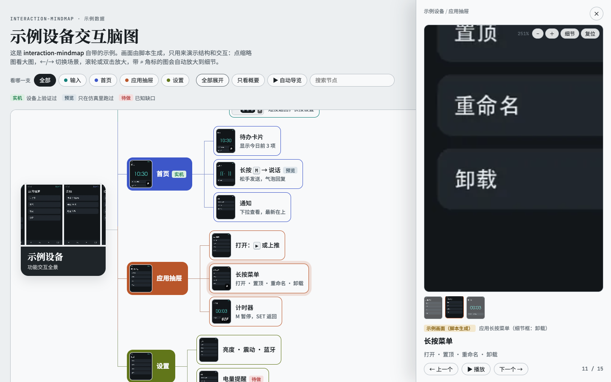
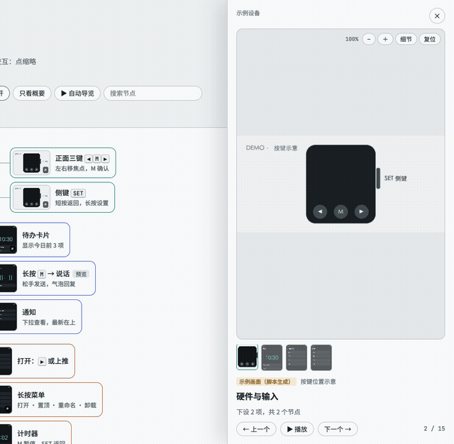
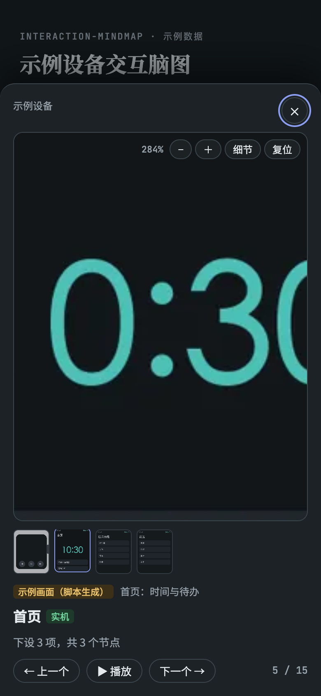
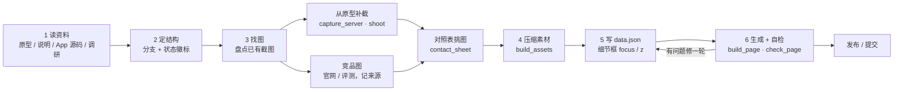

# interaction-mindmap —— 每个节点都配真实截图的功能交互脑图

[](#安装)
[](./LICENSE)
[](#安装)
[](#产出什么)

<p align="center">
  <a href="#产出什么"><strong>产出什么</strong></a> ·
  <a href="#安装"><strong>安装</strong></a> ·
  <a href="#快速开始"><strong>快速开始</strong></a> ·
  <a href="#工作原理"><strong>工作原理</strong></a> ·
  <a href="#目录结构"><strong>目录结构</strong></a>
</p>

一款 Claude 技能，把产品原型、手机 App 或一组竞品整理成**功能交互脑图网页**。和普通脑图不同，这里**每个节点都挂一张真实截图**：设备截屏、原型画面、手机实机截图或评测图，图下标明来源。点开大图后，可以按顺序切换每个功能场景、放大看细节、自动导览；节点上的徽标说明这条结论在实机上验证过、只在预览里跑过，还是仍在开发中。

<p align="center">
  
  <br/>
  <sub>技能自带示例的真实输出。示例画面由 <a href="./examples/demo/make_demo_images.py"><code>make_demo_images.py</code></a> 生成，截图由 <a href="./docs/assets/capture.py"><code>docs/assets/capture.py</code></a> 截取。</sub>
</p>

## 产出什么

- **一个单页 HTML**：脑图从左向右展开，首屏只展开到二级，点节点逐层展开，子节点依次滑入。
- **每个节点一张图**：缩略图悬停放大；`GIF` 角标是动图，`⌕` 角标表示带细节框。
- **场景切换**：大图面板里用 ← / → 按全树顺序切换，场景条一键跳到同一分支的其他场景，手机上左右滑动即可。
- **细节放大**：滚轮、双指或双击放大，拖动平移；给图片标一个细节框，切到这张图时会自动放大到那块区域（比如屏幕上的一个图标）。
- **自动导览**：每张停留几秒，脑图同步定位并高亮当前节点，适合会上演示。
- **可靠程度徽标**：实机 / 预览 / 开发中 / 待做 / 原型，团队一眼分清哪些结论站得住。
- **浅色、深色、手机宽度都可用**；系统开启「减少动态效果」时自动关闭动画。

<table>
<tr>
<td width="62%"></td>
<td width="38%"></td>
</tr>
<tr>
<td align="center"><sub>逐个切换场景，细节自动放大</sub></td>
<td align="center"><sub>手机宽度 · 深色模式</sub></td>
</tr>
</table>

## 适合什么时候用

| 场景 | 做法 |
|---|---|
| 给团队讲清楚自家原型和 App 怎么用 | 按「设备端 / 手机 App / 跨端功能 / 应用 / 旧版原型」分支，每个面板写清怎么打开、怎么关、按键在这里代表什么 |
| 竞品交互调研 | 按「品类 → 产品 → 按钮交互 / 软件交互」分支，每个叶子配一张功能场景截图 |
| 版本评审、对外演示 | 用自动导览逐个过场景，徽标标出哪些已经实机验证 |

技能负责的是结构和图：它会先盘点仓库各分支和测试证据里已有的截图，再从原型里补截缺失的状态，竞品图则从官网和评测里找，每张都写明出处。找不到专门画面的节点，就用最接近的真实画面并在图说里注明，不画假界面。

## 安装

**前提**

| 依赖 | 版本 | 用途 | 检查命令 |
|---|---|---|---|
| git | 任意 | 下载技能 | `git --version` |
| Python | 3.9+ | 运行脚本 | `python3 --version` |
| Pillow | 9+ | 压缩素材、拼对照表 | `python3 -c "import PIL; print(PIL.__version__)"` |
| Playwright | 1.40+（可选） | 批量截图、发布前自检 | `python3 -c "import playwright"` |

**Claude 桌面版 / Cowork**：下载 [`interaction-mindmap.skill`](./interaction-mindmap.skill) 并打开，点击 **Save skill**。

**安装技能（Claude Code）**

```bash
git clone https://github.com/janauto/interaction-mindmap.git
mkdir -p ~/.claude/skills
cp -r interaction-mindmap ~/.claude/skills/interaction-mindmap
python3 -m pip install --user pillow playwright
python3 -m playwright install chromium
```

pip 需要能访问 PyPI。安装依赖和运行脚本要用**同一个** `python3`：机器上装了多个 Python（如系统自带 3.9 和 Homebrew 版）时，先用 `which python3` 确认，或者建一个虚拟环境（`python3 -m venv .venv && source .venv/bin/activate`）再装。

最后一行下载 Playwright 自带的 Chromium（约 150 MB）。机器上已装 Google Chrome 时可以跳过，脚本会优先用系统 Chrome。不装 Playwright 也能用：截图改用浏览器手动截，自检改为打开页面目测。

**冒烟测试**：用自带示例生成一次页面并自检。

```bash
cd ~/.claude/skills/interaction-mindmap
python3 examples/demo/make_demo_images.py
python3 scripts/build_assets.py examples/demo/recipe.json --src examples/demo/raw --out examples/demo/site/assets
python3 scripts/build_page.py examples/demo/data.json -o examples/demo/site/index.html --strict
python3 scripts/check_page.py examples/demo/site/index.html
```

预期最后几行输出：

```text
OK: 15 个节点，9 张素材，0 个问题 → examples/demo/site/index.html
[desktop] 节点 15，无图 0，坏图 0，横向溢出 0px，脚本错误 0
[phone] 节点 15，无图 0，坏图 0，横向溢出 0px，脚本错误 0
PASS
```

用浏览器打开 `examples/demo/site/index.html` 就能看到示例页面。

<!-- 面向 AI agent 的非交互式安装（Claude Code）：
git clone https://github.com/janauto/interaction-mindmap.git && mkdir -p ~/.claude/skills && cp -r interaction-mindmap ~/.claude/skills/interaction-mindmap && python3 -m pip install --user pillow playwright && cd ~/.claude/skills/interaction-mindmap && python3 examples/demo/make_demo_images.py && python3 scripts/build_assets.py examples/demo/recipe.json --src examples/demo/raw --out examples/demo/site/assets && python3 scripts/build_page.py examples/demo/data.json -o examples/demo/site/index.html --strict
预期最后一行：OK: 15 个节点，9 张素材，0 个问题 → examples/demo/site/index.html。无需任何凭据，可重复执行。
check_page.py 需要 Chromium：已装 Google Chrome 时直接可用，否则先运行 python3 -m playwright install chromium。 -->

## 快速开始

装好后，直接对 Claude 说：

- 「根据这个仓库里的原型和 App，做一份功能交互脑图，每个节点配真实截图」
- 「把这几款竞品的按钮交互和软件交互做成脑图，每个功能场景都要有截图，能放大看细节」

技能会按下面的流程走完，最后给你页面链接（Claude 桌面版会发布为 Artifact）或 `site/` 目录。

自己手工用脚本也可以：照着 [`examples/demo/`](./examples/demo/) 写一份 `data.json`（结构见 [`references/data-schema.md`](./references/data-schema.md)），把图放进 `site/assets/`，运行 `build_page.py` 即可。

## 工作原理



| 脚本 | 作用 |
|---|---|
| [`build_page.py`](./scripts/build_page.py) | 把 `data.json` 填进页面模板；校验每个节点有图、素材文件存在、图说齐全、细节框格式正确 |
| [`build_assets.py`](./scripts/build_assets.py) | 按清单把原图压成 WebP，拼并排图、帧序列 GIF，裁局部 |
| [`contact_sheet.py`](./scripts/contact_sheet.py) | 把一批图拼成带编号的对照表，一次看完再挑图 |
| [`capture_server.py`](./scripts/capture_server.py) | 本地静态服务 + 接收 canvas 截图，用来逐个状态截 canvas 原型 |
| [`shoot.py`](./scripts/shoot.py) | 按清单用 Playwright 点按钮、改状态、截元素或整页 |
| [`check_page.py`](./scripts/check_page.py) | 桌面浅色 + 手机深色各开一次，查无图节点、坏图、脚本错误、横向溢出 |

参考文档：[结构怎么搭](./references/tree-design.md) · [图怎么找](./references/image-sourcing.md) · [data.json 字段](./references/data-schema.md) · [页面交互与发布](./references/page-and-publish.md)

## 目录结构

```text
interaction-mindmap/
├── SKILL.md                 技能入口：原则与六步流程
├── assets/template.html     页面模板（脑图、大图面板、细节放大、导览）
├── scripts/                 生成、压缩、截图、自检脚本
├── references/              结构、找图、数据格式、发布四份参考
├── examples/demo/           示例：脚本生成的画面 + recipe.json + data.json + 生成好的 site/
└── docs/assets/             README 截图及其生成脚本 capture.py
```

## 许可证

[MIT](./LICENSE)
